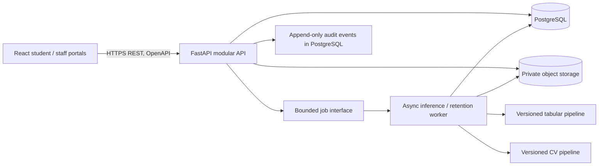

# AI-Powered Assessment Proctoring Platform

## Phase 0 — Discovery, architecture, and roadmap (historical)

**Status at Phase 0 close:** Planning only. No application code or dataset files had yet been created or downloaded. Current implementation status is tracked in `IMPLEMENTATION_STATUS.md`.

## 1. Product and design constraints

Build an original online assessment platform with secure exam workflows and optional, consent-based AI observations. The platform serves students, instructors/invigilators, administrators, and a restricted ML maintainer role.

The governing product rules are:

- AI outputs are reviewable observations for a human; they are never proof of cheating and never trigger automatic grading penalties, failure, or discipline.
- Do not infer intent, honesty, emotion, attention, personality, or mental state. A gaze direction, head pose, detected object, or model label is an observable signal only.
- Require informed, versioned consent and a visible camera state before frame capture. Provide a no-camera/accommodation route.
- Use sampled frames with a configurable low capture rate, ephemeral processing where possible, short configurable evidence retention, access auditing, and deletion controls. Do not record continuously by default.
- Keep raw detections, derived/aggregated events, and human review decisions as distinct records.
- Display source observations and model/version metadata. Do not present a composite risk score until calibration and limitations are independently evaluated; start with transparent signal counts and event descriptions.
- Keep all application source independently authored. Dataset and model inputs require separate provenance and license records.

## 2. Proposed architecture

Use a **modular monolith for the product API** and isolated ML/CV execution modules behind asynchronous jobs. This keeps the first deployment understandable while preventing inference latency or failures from blocking exam operations. Split into separately deployed services only if measured load, operational ownership, or security boundaries justify it.



### Stack proposal

| Layer | Proposal | Boundary / rationale |
|---|---|---|
| Web | React, TypeScript, Vite; Tailwind; accessible component primitives; React Router; TanStack Query; React Hook Form + Zod; Recharts; Lucide | Typed API client and shared design tokens; charts only from API-backed data or clearly identified demo fixtures. |
| API | Python, FastAPI, Pydantic, SQLAlchemy 2.x, Alembic | Versioned REST API (`/api/v1`); OpenAPI generated from schemas. Feature modules own their authorization and service logic. |
| Persistence | PostgreSQL | UUID primary keys, foreign keys, constraints, indexes, UTC timestamps, transactional exam state changes. |
| Evidence | Private S3-compatible object storage (MinIO locally; deployment provider TBD) | Store object keys and metadata in PostgreSQL, never large binary evidence in relational rows. Signed access must be short-lived and authorized/audited. |
| Jobs | Start with a small worker interface and bounded in-process/local queue for development; add Redis-backed durable queue only when retry/durability requirements need it | Job idempotency, bounded queues, timeouts, retry policy, and backpressure must be explicit. Exam answer saves never depend on inference completion. |
| Tabular ML | Pandas, NumPy, scikit-learn | Reproducible scripts, fitted preprocessing + estimator artifact, locked evaluation, schema-checked inference. |
| Vision | OpenCV plus a detector selected after dataset/model license and hardware review | CPU fallback or explicit unavailable state. Candidate frameworks are not selected in Phase 0. |
| Delivery | Docker Compose, CI, environment-based configuration and secret manager in deployment | Local reproducibility, no secrets committed, health/readiness checks and deployment docs. |

### Proposed original repository layout

```text
.
├── apps/
│   └── web/                         # React application, routes, feature modules, design system
├── services/
│   └── api/                         # FastAPI application and domain modules
├── packages/
│   └── contracts/                   # Shared generated API types / schemas where useful
├── ml/
│   ├── tabular/                     # Dataset manifests, EDA, training, evaluation, inference
│   └── vision/                      # Dataset validation, annotations, training, evaluation, inference
├── infra/                           # Compose, CI, deployment and operational configuration
├── docs/                            # Architecture, SRS, diagrams, test and deployment plans
├── artifacts/                       # Local ignored model/evaluation outputs; never source data by default
├── .env.example
├── IMPLEMENTATION_STATUS.md
└── README.md
```

This is a proposed tree, not a created scaffold. Dataset files, webcam evidence, credentials, and trained weights must not be committed by default.

## 3. Domain model and persistence design

Use UUID identifiers, UTC `created_at`/`updated_at`, explicit lifecycle status fields, foreign keys, and database constraints. Add tenant/institution scoping only if the intended deployment requires it; current SRS describes courses and roles but does not define multi-tenant isolation.

| Entity | Key relationships and design notes |
|---|---|
| `User` | Unique normalized email, password hash, active/locked state, timestamps. No plaintext secrets. |
| `Role`, `UserRole` | Roles: student, instructor/invigilator, administrator, ML maintainer. Separate assignment enables least privilege and future multi-role users. Enforce capabilities server-side. |
| `Course`, `CourseMembership` | Instructor ownership and student membership; scoped access for exams and reports. |
| `Exam` | Owner/course, lifecycle draft/scheduled/published/archived, availability window, duration, attempts policy, consent/policy version references. Publish validation is transactional. |
| `Question` | Exam or reusable bank ownership, type (MCQ/descriptive), marks, order, validation. Keep answer key/rubric out of student-facing response schemas. |
| `ExamAssignment` | Exam-to-student/course targeting; unique assignment per target; eligibility and accommodation status. |
| `ExamAttempt` | Student + exam + attempt number; unique constraint for policy; server-authoritative start/deadline/state; idempotent submit key. |
| `Answer` | Attempt + question unique; answer payload, saved version, server timestamp. Autosave uses idempotency/version checks and does not wait on AI. Objective scores computed server-side after submission. |
| `ProctoringSession` | Attempt, consent record/version, camera state, preflight result, session lifecycle and sampling policy. Session can be absent where an alternative process is used. |
| `ProctoringEvent` | Session, event kind, source (`client/system/model`), timestamp, neutral description, raw model payload, model version, deduplication/aggregation linkage. Preserve raw observation separately from reviewer status. |
| `EvidenceAsset` | Event/session, private storage object key, MIME/size/hash, retention expiry/deletion state. Access through an authorization check and audited short-lived URL. |
| `ReviewDecision` | Event, reviewer, action (reviewed/dismissed/needs-follow-up), notes, timestamp. Append revisions rather than erasing prior reviewer actions. |
| `DatasetVersion` | Dataset identity, source/authors/license/attribution/version, retrieval date/hash, schema/classes/split/limitations and approval state. |
| `ModelVersion` | Pipeline and model provenance, framework/license/weights provenance, dataset hashes, feature/class schema, artifact URI/hash, code revision, model card and lifecycle state. |
| `ExperimentRun` | Dataset/model references, config, seed, split, metrics, logs/artifact references, start/end/status. Metrics are outputs, not hard-coded dashboard values. |
| `AuditLog` | Actor, action, resource, result, timestamp, request correlation and minimal context; append-only application behavior, with evidence reads and admin changes included. |

### Data invariants

- Exam publication, attempt creation, autosave, and submission validate permissions and state in the API and enforce race-sensitive rules with transactions/constraints.
- Student response DTOs never include correct MCQ keys or private instructor notes.
- Attempts are immutable after final submission except explicitly audited grading/reopen operations.
- One attempt/question answer row; autosave updates it with idempotency and ordering protection.
- Evidence retrieval checks role, course/exam ownership, retention status, and purpose before each access; every read is audited.
- Retention expiry and deletion are explicit state transitions, including object deletion and audit evidence that deletion ran. Avoid keeping deleted raw frames in backups longer than the published policy permits.
- Dataset/model registry entries carry provenance and limitations; experiment metrics link to exact dataset hash, split, config, and code revision.

## 4. API module map

All routes are under `/api/v1`; schemas are Pydantic-validated; authorization and ownership checks belong in server services, not only UI guards. The route set is a design outline, not implemented endpoints.

| Module | Initial route groups |
|---|---|
| Health | `GET /health/live`, `GET /health/ready` |
| Auth | `POST /auth/login`, `POST /auth/logout`, `POST /auth/refresh`, `GET /auth/me` (session/token mechanism selected in Phase 1 after threat model) |
| Users / roles | `GET/POST /users`, `GET/PATCH /users/{id}`, role assignment and deactivation (admin-only, audited) |
| Courses | `GET/POST /courses`, membership and instructor assignment endpoints |
| Exams / questions | `GET/POST /exams`, `GET/PATCH /exams/{id}`, publish/archive actions; question create/update/reorder endpoints, role/ownership scoped |
| Assignments | create/list/revoke exam assignments, eligibility and accommodation workflow |
| Attempts / answers | eligible exam list, attempt start, answer read/write/autosave, reconnect state, idempotent final submit and result retrieval |
| Consent / preflight | policy version retrieval, explicit consent decision, device/preflight result; no capture before consent |
| Proctoring | session lifecycle, sampled frame/detection submission, neutral event list, bounded async inference job status |
| Review / evidence | event queue/detail, evidence authorization, review action and append-only reviewer notes |
| Analytics / reports | role-scoped exam/session aggregates and CSV/PDF export jobs; no synthetic values in production views |
| ML registry | dataset versions, experiment runs, model versions, model cards, schema-validated inference; restricted ML maintainer access |
| Admin / audit / retention | retention policies, deletion jobs, audit search with redaction and export controls |

## 5. Dataset and model shortlist (Phase 0 verification)

### Tabular candidate: Mendeley Data record

The specified live record is [“Students suspicious behaviors detection dataset for AI-powered online exam proctoring”](https://data.mendeley.com/datasets/39xs8th543/1), DOI `10.17632/39xs8th543.1`. The record currently lists Muhammad Kamal Hossen and Mohammad Shorif Uddin, publication date 8 July 2025, version 1, and CC BY 4.0. Its description reports 5,500 records, 38 attributes, two labels, and says data were collected from 30+ volunteers in controlled simulated exam scenarios. The record describes labels as manually annotated using observation logs/session context and states no raw images or personal identifiers are included.

**Decision: candidate only; not approved as a truth source or downloaded in Phase 0.** Before use in Phase 3, inspect the exact files, schema, feature definitions, label construction, participant/session identifiers (or their absence), duplicates, and source documentation. Maintain a manifest with canonical record, attribution, exact license, retrieval date, SHA256 and limitations. A random stratified split is not evidence of generalization if participant/session IDs are absent; call this limitation out and treat resulting metrics as exploratory. Do not label model outputs “cheating”; use neutral observable-signal language. The dataset's simulated binary labels risk encoding the collection protocol and assumptions rather than valid evidence of misconduct.

### Vision candidates

| Candidate | License/provenance status | Phase 0 recommendation |
|---|---|---|
| Consent-based, institution-approved original webcam frames with written annotation policy | No data collected or institutional approval exists yet; future consent, purpose, retention and participant protection required | Preferred for any task tied to the platform's actual capture conditions. Do not collect until governance, consent, annotation, and storage controls are approved. |
| COCO generic object data | Official terms state annotations/website are CC BY 4.0, while the COCO Consortium does not own the images and image use must follow Flickr terms | Optional generic detector pretraining/evaluation only after image-level rights review. Not an exam/proctoring or misconduct dataset; object presence cannot establish misconduct. |
| Individual Roboflow Universe projects | Each project has its own license; no project is approved or identified at this phase | Candidate discovery source only. Before selection, verify the exact project/version, license in the project and export, class definitions, attribution, image rights, and whether the license permits intended use. |

For detector software and weights, evaluate an Apache-2.0/BSD/MIT option only after verifying the exact implementation, pretrained checkpoint and dataset provenance separately. **Do not select Ultralytics YOLO for a proprietary/closed deployment without a deliberate AGPL-3.0 compliance decision or appropriate commercial license.** Current vendor licensing material describes AGPL-3.0 obligations and an Enterprise license path. The model/framework and weight licenses must be recorded independently; a permissive code license does not make training data rights permissive.

No large dataset or pretrained weights were downloaded. Phase 4 begins with candidate-specific license, data quality, and hardware review.

## 6. Security, privacy, and reliability risks

| Risk | Planned control / unresolved decision |
|---|---|
| False accusations or biased signals | Neutral labels; human review; no automatic penalty; separate observation from decision; accessible alternative process; no mental-state inference. Later evaluate subgroup limitations only where lawful and ethically approved. |
| Unauthorized evidence access / IDOR | Deny-by-default RBAC plus ownership checks on every API; short-lived authorized evidence URLs; audit each view/download; dedicated negative security tests. |
| Excessive webcam data collection | Explicit versioned consent; visible status; sampled frames; minimize payload; configurable retention; deletion job; accommodation path. Set capture frequency and retention defaults before implementation. |
| Leaked test data or unrepresentative ML metrics | Group split by person/session if possible, leakage audit, locked test set, baselines, confidence/threshold reporting, no accuracy claims until actual run; document dataset limitations. |
| Inference outage delays exam | Asynchronous bounded queue, timeouts, graceful AI unavailable state; autosave and submit are independent. |
| Queue loss / duplicate processing | Begin simple; define idempotency and retries. Decide Redis/durable worker after workload and operational needs are measured. |
| Sensitive information in logs/backups | Redact credentials/answers/evidence; define backup retention/deletion compatibility and access; no secrets in repository. |
| Tenant boundary ambiguity | SRS does not specify institution/tenant model. Initial design scopes by course and owner; revisit before Phase 2 schema/API work if multi-institution use is expected. |
| Scope and placement-level timeline | Deliver vertical slices and acceptance gates; no feature marked complete without working path and recorded verification. Actual schedule depends on team size, GPU access, institutional data and deployment target. |
| Object storage/deployment choices | S3-compatible contract with MinIO local; cloud provider, region, TLS, secret manager, backups and budget remain TBD. |
| Legal/privacy policy | Jurisdiction, institution policy, age range, retention duration, accessibility/accommodation authority and consent wording are unresolved and require stakeholder review before real students/data. |

## 7. Milestones and acceptance criteria

Phases follow the requested sequence. Phase 0 is this proposal only; Phase 1 starts only after explicit approval.

| Phase | Scope | Exit / acceptance criteria |
|---|---|---|
| 0 — Discovery/design | Architecture, repo layout, API/domain outline, data shortlist/license review, risks, milestones | Planning docs reviewed; open product choices identified; user approves Phase 1. No app code. |
| 1 — Foundation | Original monorepo scaffold, visual system and responsive shell, API skeleton, PostgreSQL/migrations, Compose, CI, health checks | Clean documented local start; migration applies; web and API build; health/readiness works; baseline CI/lint/type/test commands pass and outputs recorded. |
| 2 — Exam lifecycle | Auth/session, RBAC, users/courses, question bank, exams/assignments, student attempt, timer, autosave/reconnect, submit | Student and instructor end-to-end lifecycle works; server owns availability/permissions/scoring; duplicate submission and authorization tests pass; no answer-key disclosure. |
| 3 — Tabular ML | Verify dataset and manifest; EDA; leakage analysis; baselines; training/evaluation; model card and strict inference schema | Reproducible run from documented data input; split strategy justified; locked-test metrics generated from actual held-out data; artifact save/load and schema tests pass; limitations visible. Stop/re-scope if data provenance or task validity fails. |
| 4 — Vision | Validate separately licensed dataset; annotation spec; detector training/fine-tune; evaluation; versioned inference API | Data rights and subject-use evidence reviewed; person/session/source separation where possible; metrics include per-class precision/recall/AP and latency from a locked test split; corrupt/no/multiple/timeout paths verified; inference failures do not block attempts. A public dataset license alone does not establish consent for downstream image use. |
| 5 — Consent and review | Consent/versioning, preflight, sampled capture, event ingestion/deduplication, aggregation, reviewer workflow | No capture without consent; visible camera state; no-camera route; audit evidence access; reviewer can dismiss/follow up; no automated discipline; retention/deletion behavior demonstrated. |
| 6 — Analytics and polish | API-backed reports/analytics, exports, audit, retention controls, accessibility and visual refinement | Charts reflect real API data or explicit demo labels; exports are authorized; key flows keyboard-accessible/responsive; retention and deletion behavior documented and checked. |
| 7 — Release readiness | Security review, IDOR/privilege tests, load/E2E, deployment, monitoring, demo and docs | Reproducible deployment guide; security and test results recorded; known gaps and model limitations disclosed; end-to-end demo uses synthetic or consented data and never presents fabricated metrics. |

### Verification policy for every phase

At phase close, report exact changed files, decisions, exact commands, real command outputs, unresolved issues/limitations, and update `IMPLEMENTATION_STATUS.md`. Keep implemented, tested, partial, and planned states distinct. Stop for user approval before the next phase.

## 8. Decisions needed before later phases

These do not block the Phase 0 proposal but should be resolved before the corresponding implementation:

1. Is the target portfolio/demo deployment open source, private, or potentially commercial? This affects detector and pretrained weight license selection.
2. Is this single-institution, multi-institution, or portfolio-only? This affects tenancy and data isolation.
3. What jurisdiction, student age range, institutional privacy rules, retention period, and approved camera accommodation process apply?
4. What hardware is available for model training/inference (CPU only, local GPU, or approved cloud GPU), and what budget applies?
5. Which deployment target and domain should Phase 7 support?
6. Can an institution provide consented, rights-cleared representative images/session data, or should the project remain a non-production prototype with synthetic demonstrations and a limited public generic-object evaluation?

## 9. Phase 0 deliverables and run commands

Created in Phase 0:

- `docs/phase-0-architecture-and-roadmap.md` — this architecture, domain/API design, dataset shortlist, risks, milestones and acceptance criteria.
- `IMPLEMENTATION_STATUS.md` — current phase and scope status.

No application code, tests, model, dataset, Docker configuration or deployment has been created in this phase. No build/test command applies yet. To inspect the planning document locally:

```sh
sed -n '1,240p' docs/phase-0-architecture-and-roadmap.md
```

**Historical next action at Phase 0 close:** review Phase 0 and approve Phase 1. Subsequent phase approvals and work are tracked in `IMPLEMENTATION_STATUS.md`.
